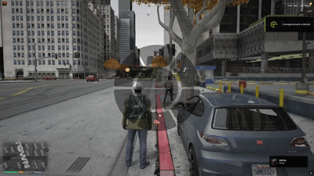

# blnt_itemWheel

A clean, responsive, and performance-optimized item shortcut wheel for FiveM servers using **ox_inventory**, built with **React** and **Lua**.

Inspired by weapon wheels from modern action titles, `blnt_itemWheel` allows players to hold a key to bring up their first 5 inventory slots alongside an unarmed/disarm slot, preview items with real-time selection feedback, and trigger items instantly upon key release.



---

## Features

* **Direct ox_inventory Integration**: Automatically retrieves the first 5 item slots directly from `ox_inventory:GetPlayerItems()`.
* **Hold-to-Aim / Release-to-Use**: Hold `TAB` to reveal the radial wheel, point toward the desired slot, and release to consume or equip.
* **Dedicated Unarmed / Disarm Sector**: Sixth sector mapped to `ox_inventory:disarm` to quickly holster weapons.
* **Directional Polar Math**: Responsive selection driven by angle calculations (`Math.atan2`) from the wheel's center.
* **Configurable Theme**: Customize background tones, borders, and accent glow colors via `shared/config.lua`.
* **Custom Item Support**: Supports default ox_inventory item icons, local fallback images, and empty slot indicators.

---

## Preview

| Radial Layout | Description |
| --- | --- |
| **Slots 1 to 5** | Maps directly to the player's primary inventory hotbar slots. |
| **Slot 6 (Bottom)** | Dedicated unarmed hand icon for quick weapon holstering. |

---

## Dependencies

* [ox_inventory](https://github.com/overextended/ox_inventory)

---

## Installation
Ensure the resource starts in your `server.cfg` after `ox_inventory`:
```cfg
ensure ox_inventory
ensure blnt_itemWheel

```


---

## Configuration

Customize colors and wheel appearance in `shared/config.lua`:

```lua
Config = {}

-- Accent color highlighted on hovered sectors
Config.PrimaryColor = '#00f0ff'
Config.PrimaryColorGlow = 'rgba(0, 240, 255, 0.22)'

-- Slot background styling
Config.SlotBackgroundColor = 'rgba(22, 34, 46, 0.42)'
Config.SlotBackgroundColorHover = 'rgba(22, 34, 46, 0.42)'

-- Perimeter borders
Config.BorderColor = 'rgba(255, 255, 255, 0.18)'

```

---

## Controls

| Key | Action |
| --- | --- |
| `TAB` (Hold) | Open the radial shortcut wheel |
| `Mouse Move` | Select slot based on cursor angle |
| `TAB` (Release) | Use selected item or holster weapon |

*Keybindings can be remapped in GTA V Settings -> Key Bindings -> FiveM.*

---
